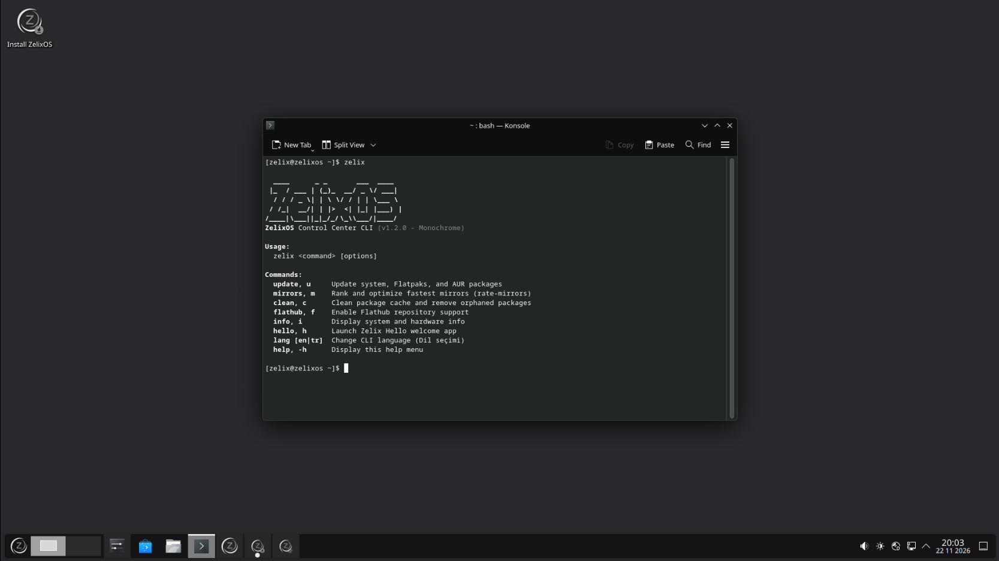

# Zelix CLI

Zelix CLI is a Bash command-line companion for ZelixOS. It provides shortcuts for system updates, package maintenance, mirrors, Flathub, system information, and Zelix Hello.



The command messages support English, Turkish, and Spanish. The language is detected from the environment on first use and can be saved with `zelix lang`.

## Install

On ZelixOS with ZelixRepo configured:

```bash
sudo pacman -Syu zelix-cli
```

Confirm the command is available and list its help:

```bash
zelix help
```

## Command reference

| Command | What it does | Notes |
| --- | --- | --- |
| `zelix update` / `zelix u` | Updates pacman repositories, then Flatpak if installed. If Paru or Yay is installed, it uses that helper for the system upgrade. | AUR helper may build/install AUR updates. Review helper prompts. Flatpak update runs with `-y`. |
| `zelix mirrors` / `zelix m` | Ranks Arch mirrors and writes the result to `/etc/pacman.d/mirrorlist`. | Uses `rate-mirrors`; if it is missing, the command attempts to install it or use Reflector. Requires administrator access. |
| `zelix clean` / `zelix c` | Runs `pacman -Sc`, then removes packages detected as orphans. | Uses `--noconfirm`; cached package versions and orphaned packages are removed without an interactive confirmation. |
| `zelix flathub` / `zelix f` | Installs Flatpak if needed and adds the Flathub remote. | Does not install a Flatpak app. |
| `zelix info` / `zelix i` | Displays system information with Fastfetch when present. | Falls back to OS, kernel, uptime, desktop, and memory details. |
| `zelix hello` / `zelix h` | Opens Zelix Hello. | Requires Zelix Hello to be installed. |
| `zelix lang en`, `tr`, or `es` | Sets the command language. | Also accepts `english`, `turkish`, and `spanish`. |
| `zelix help` | Shows command help. | Also available as `zelix -h` or `zelix --help`. |

### Examples

```bash
zelix info
zelix lang es
zelix mirrors
zelix update
```

Run `zelix clean` only when you are comfortable removing old package cache files and automatically detected orphaned packages. It does not ask for confirmation.

## Language preference

The selected language is stored in `zelix/cli.conf` under the XDG configuration directory. By default this is `~/.config/zelix/cli.conf`; when `XDG_CONFIG_HOME` is set, the preference is stored there instead. Before a preference exists, `LC_ALL`, `LC_MESSAGES`, and `LANG` determine the language.

## Dependencies and permissions

The script requires Bash, pacman, and sudo. Some commands also need Flatpak, `rate-mirrors` or Reflector, Fastfetch, Paru/Yay, or Zelix Hello. Commands that require elevated access invoke `sudo`; for example, package cleanup and mirror-list changes affect the system.

## Run from source and build

```bash
git clone https://github.com/ZelixOS/zelix-cli.git
cd zelix-cli
bash zelix help
```

Build the Arch package as a regular user on an Arch-based system with `base-devel`:

```bash
makepkg -s
```

The PKGBUILD is maintained in [ZelixRepo](https://github.com/ZelixOS/zelix-repo/tree/main/zelix-cli). Keep translations in `zelix` synchronized when adding or changing user-visible messages.

## Troubleshooting

- **`command not found`:** install the package, or invoke the source with `bash zelix help` from the cloned directory.
- **A command asks for a password or fails permission checks:** confirm sudo access and, for graphical authentication, an active Polkit agent.
- **Mirror ranking fails:** check connectivity and the configured package repositories; the mirror command edits the system pacman mirror list.
- **The update did not include a package:** identify whether it comes from pacman, AUR, or Flatpak and update it with the matching tool.
- **Zelix Hello will not open:** install `zelix-hello` and confirm its executable is on `PATH`.

## Contributing

Include the command, its arguments, shell version, ZelixOS version, and relevant output when reporting a problem. Remove private system details from logs. Changes to command messages should include English, Turkish, and Spanish.
